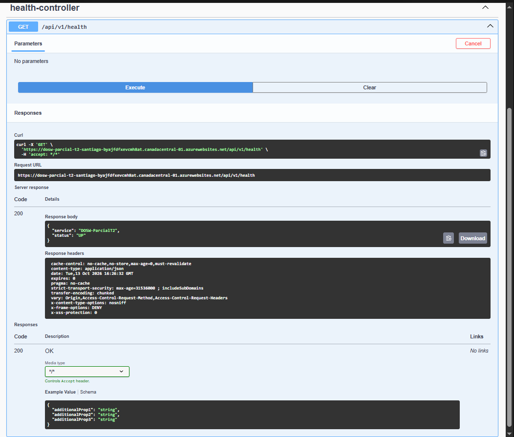
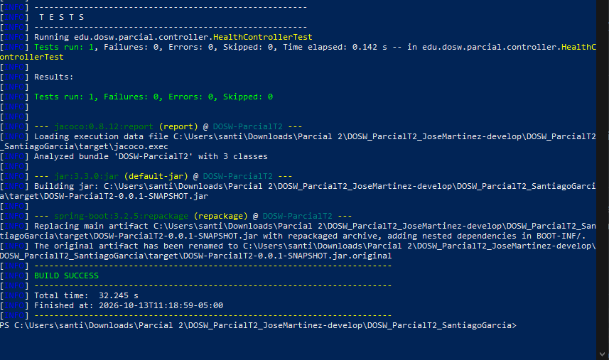
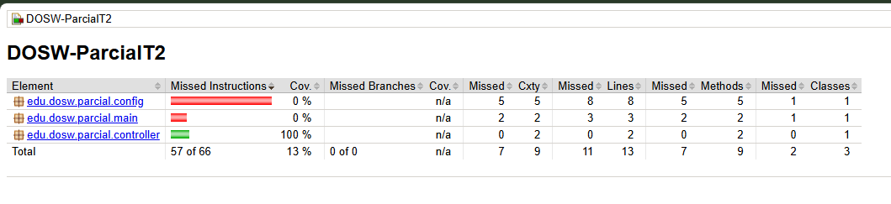
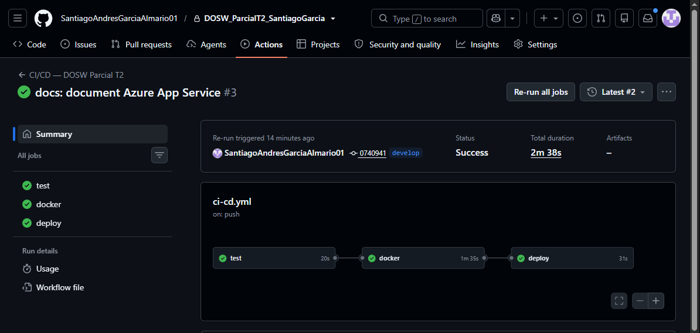
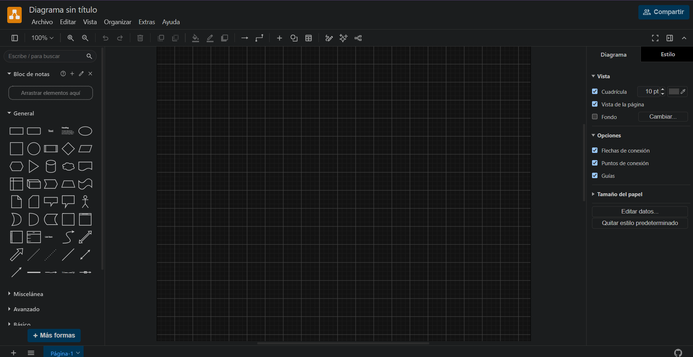
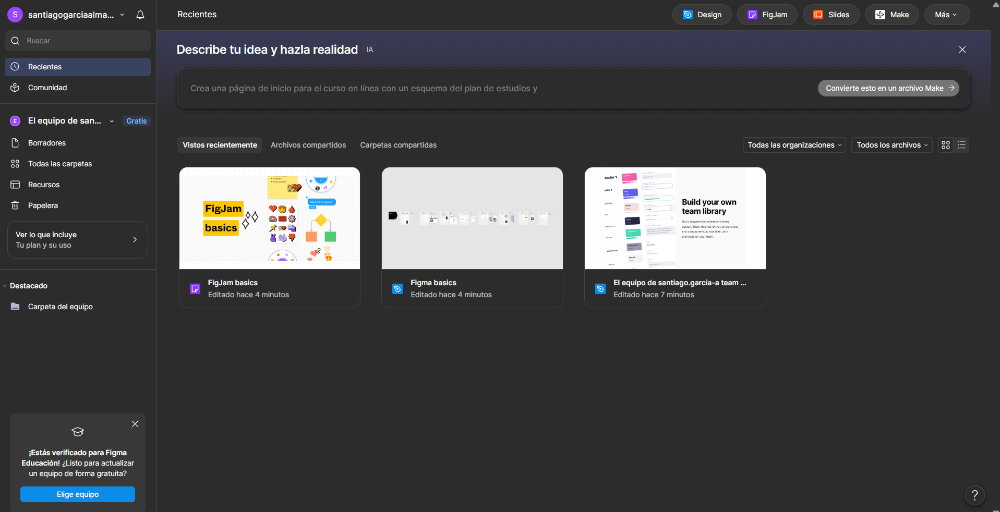

# DOSW_ParcialT2_SantiagoGarcia

> Repositorio individual para los prerrequisitos del Parcial Práctico del Segundo Tercio.

## Índice

1. [Datos del estudiante](#1-datos-del-estudiante)
2. [Descripción del proyecto](#2-descripción-del-proyecto)
3. [Despliegue](#3-despliegue)
4. [Estructura del proyecto](#4-estructura-del-proyecto)
5. [Tecnologías y dependencias](#5-tecnologías-y-dependencias)
6. [Configuración y variables de entorno](#6-configuración-y-variables-de-entorno)
7. [Cómo ejecutar](#7-cómo-ejecutar)
8. [Pruebas](#8-pruebas)
9. [Docker](#9-docker)
10. [CI/CD](#10-cicd)
11. [Herramientas de modelado y diseño (evidencias)](#11-herramientas-de-modelado-y-diseño-evidencias)

## 1. Datos del estudiante

- **Nombre completo:** Santiago Andres Garcia Almario
- **Grupo:** 1

## 2. Descripción del proyecto

Servicio REST base para el Parcial Práctico del Segundo Tercio de DOSW. Usa Spring Boot, MongoDB y una estructura MVC por capas. Incluye un endpoint de salud, documentación Swagger y archivos de apoyo para construir y publicar el servicio.

## 3. Despliegue

- **App Service:** `dosw-parcial-t2-santiago` (Canada Central, plan Linux B1)
- **Grupo de recursos:** `rg-dosw-parcialt2-santiago`
- **URL:** <https://dosw-parcial-t2-santiago-byajfdfxevcmh8at.canadacentral-01.azurewebsites.net>
- **Costo estimado del plan:** 13.14 USD/mes; el consumo de créditos de Azure for Students depende del saldo disponible.
- **Base de datos:** Azure DocumentDB (MongoDB compatible), `docdb-parcialt2-santiago`, Canada Central. La URI está configurada como variable de entorno y no debe publicarse.
- **Estado:** despliegue completado desde GitHub Actions. Swagger carga y la operación de salud respondió HTTP 200 con `{"service":"DOSW-ParcialT2","status":"UP"}`.
- **Health:** <https://dosw-parcial-t2-santiago-byajfdfxevcmh8at.canadacentral-01.azurewebsites.net/api/v1/health>
- **Swagger:** <https://dosw-parcial-t2-santiago-byajfdfxevcmh8at.canadacentral-01.azurewebsites.net/swagger-ui/index.html>
- **Ejecución CI/CD:** [workflow exitoso en GitHub Actions](https://github.com/SantiagoAndresGarciaAlmario01/DOSW_ParcialT2_SantiagoGarcia/actions/runs/38420076864) (jobs `test`, `docker` y `deploy` completados).



## 4. Estructura del proyecto

```text
docs/                           Diagramas, exportes y evidencias
src/main/java/edu/dosw/parcial/
├── controller/                 API REST, DTOs, mappers y handlers
├── core/                       Servicios, modelos, validadores y utilidades
├── persistence/                Documentos, repositorios y mappers MongoDB
├── config/                     Configuración de seguridad y OpenAPI
└── main/                       Punto de entrada de Spring Boot
src/main/resources/             application.yaml
src/test/java/                  Pruebas automatizadas
.github/workflows/ci-cd.yml     Pipeline de GitHub Actions
Dockerfile                      Construcción multietapa
pom.xml                         Dependencias y plugins Maven
```

Los paquetes `controller/mappers` y `persistence/mappers` separan el mapeo de entrada DTO↔dominio del mapeo de salida dominio↔documento. Los controladores no reciben documentos MongoDB y los servicios no dependen de DTOs.

## 5. Tecnologías y dependencias

| Tecnología | Versión | Uso |
|---|---:|---|
| Java | 21 | Lenguaje y runtime |
| Spring Boot | 3.2.5 | Aplicación web y configuración |
| Spring Data MongoDB | BOM de Spring Boot | Persistencia documental |
| Spring Security | BOM de Spring Boot | Reglas de acceso base |
| JJWT | 0.12.3 | Soporte para JWT |
| Springdoc OpenAPI | 2.5.0 | Swagger UI |
| MapStruct | 1.5.5.Final | Mapeo entre capas |
| Lombok | 1.18.38 | Reducción de código repetitivo |
| JaCoCo | 0.8.12 | Reporte de cobertura |
| Sonar Maven Plugin | 3.10.0.2594 | Análisis estático |
| Docker | 21 (imagen base Java) | Empaquetado del servicio |

JUnit y Mockito se incluyen mediante `spring-boot-starter-test`.

## 6. Configuración y variables de entorno

| Variable | Descripción | Ejemplo no real |
|---|---|---|
| `MONGODB_URI` | URI de MongoDB; por defecto usa Mongo local | `mongodb://localhost:27017/dosw_parcial` |
| `JWT_SECRET` | Secreto Base64 para JWT, mínimo 44 caracteres | `<secreto-base64>` |
| `PORT` | Puerto HTTP | `8080` |
| `WEBSITES_PORT` | Puerto que Azure enruta al contenedor | `8080` |

No almacene secretos, URI con credenciales, archivos `.env` ni certificados `.p12` en Git. `JWT_SECRET` debe definirse en el entorno antes de iniciar la aplicación.

## 7. Cómo ejecutar

Requiere JDK 21 y Maven. En una terminal PowerShell:

```powershell
docker run -d -p 27017:27017 --name mongo-parcial mongo:7
$env:JWT_SECRET = '<secreto-base64-de-44-caracteres-o-mas>'
mvn spring-boot:run
```

El servicio escucha en `http://localhost:8080`. El endpoint público de salud es `http://localhost:8080/api/v1/health`; Swagger está disponible en `http://localhost:8080/swagger-ui/index.html`.

## 8. Pruebas

Ejecute `mvn test` para las pruebas unitarias y `mvn verify` para la verificación completa. JaCoCo genera su reporte en `target/site/jacoco/`.

**Verificación:** `mvn verify` terminó con `BUILD SUCCESS`; Surefire reportó 1 prueba, 0 fallos y 0 errores. El reporte JaCoCo registra 13% de cobertura global y 100% en el controlador probado.





## 9. Docker

```powershell
docker build -t dosw-parcial:local .
docker run --rm -p 8080:8080 -e JWT_SECRET='<secreto-base64>' -e MONGODB_URI='mongodb://host.docker.internal:27017/dosw_parcial' dosw-parcial:local
```

La imagen usa una etapa Maven para compilar y una imagen Java 21 JRE para ejecutar. `.dockerignore` excluye Git, documentación, archivos Markdown, `target/` y secretos.

**Publicación:** el job `docker` del [workflow exitoso](https://github.com/SantiagoAndresGarciaAlmario01/DOSW_ParcialT2_SantiagoGarcia/actions/runs/38420076864) finalizó correctamente. La ejecución local de `docker build`/`docker run` no se documenta como evidencia porque el daemon de Docker no respondió en este equipo durante la revisión. Falta una captura propia del contenedor local en ejecución, si el evaluador la exige.

## 10. CI/CD

`.github/workflows/ci-cd.yml` define tres etapas: verificación con Maven, publicación de la imagen en Docker Hub y despliegue a Azure App Service. Se activa con cambios en `main` o `develop`.

Secrets requeridos en GitHub: `DOCKERHUB_USERNAME`, `DOCKERHUB_TOKEN`, `AZURE_CREDENTIALS`, `AZURE_WEBAPP_NAME` y `JWT_SECRET`. El job de publicación/despliegue requiere la variable de Actions `DEPLOY_ENABLED=true`. Configure además `MONGODB_URI`, `JWT_SECRET` y `WEBSITES_PORT=8080` en Azure App Service.

**Estado:** verificación, publicación de imagen y despliegue a Azure completados correctamente en el [run 38420076864](https://github.com/SantiagoAndresGarciaAlmario01/DOSW_ParcialT2_SantiagoGarcia/actions/runs/38420076864). Los valores de secrets y de `MONGODB_URI` no se incluyen en el README ni en capturas.



## 11. Herramientas de modelado y diseño (evidencias)

- **Herramienta de modelado — Draw.io:** evidencia de la herramienta abierta: [evidencia-drawio.png](docs/images/evidencia-drawio.png).



- **Figma:** evidencia de sesión y archivos recientes: [evidencia-figma.png](docs/images/evidencia-figma.png).



Las capturas de Draw.io, Figma, Health, Maven, JaCoCo y GitHub Actions se incorporaron a `docs/images/`. No se reutilizaron imágenes del ZIP de referencia porque pertenecen a otra entrega.
